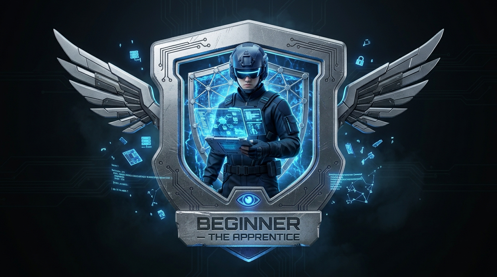

# Cloudbreak Pipeline -- Gitleak



**Difficulty: Beginner tier.** The second box of **Cloudbreak
Pipeline**, a new 8-tier red-team game -- a separate ladder from
[The Halcyon Protocol](https://github.com/A3lxq?tab=repositories&q=synnefo-)
series, telling one escalating cloud-native/DevOps red-team engagement
against the fictional "Nimbus Freight" logistics startup.

This box: a real exposed `.git` directory, built fresh every boot so
per-team flags live inside the actual commit blobs -- a genuine
`git clone` against it recovers a deploy secret removed from HEAD but
still sitting in history, the classic real-world "exposed `.git`
directory" bug class. That secret reveals a hidden-but-live admin
panel, SSH foothold via credential reuse, and a sudo/GTFOBins
(`python3`) privilege escalation. 10 real flags, no decoys.

## Running it

This box is built and provisioned per-team by
[ctf-orchestrator](https://github.com/A3lxq/CTF-orchestrator) (Docker
or Kubernetes backend) -- this repo holds the box's own source
(`docker/Dockerfile`, `docker/entrypoint.sh`, the per-team
`CTF_SECRET`/HMAC flag scheme) which the orchestrator pulls in as a git
submodule under its own `boxes-src/cloudbreak-beginner-gitleak/`.

To build and run it standalone for testing:
```bash
cd docker
docker build -t ctf-boxes/cloudbreak-beginner-gitleak:latest .
docker run -d -e CTF_SECRET=<any-string> -p 22:22 -p 80:80 \
    ctf-boxes/cloudbreak-beginner-gitleak:latest
```
